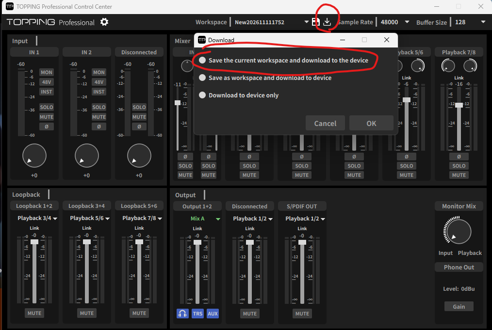

# Controller for TOPPING E2x2 OTG (Stream Deck plugin)

[한국어](README.md) | **English** | [日本語](README.ja.md)

A plugin that controls the **TOPPING E2x2 OTG** mixer with the keys and dials of an Elgato Stream Deck. It talks to the device directly over USB (HID). You choose a Mix and a channel for each key, and the key moves only that target, whichever Mix the TOPPING app happens to be showing.

## Download

Get `TOPPING-E2x2-OTG-StreamDeck-v<version>.zip` from the [latest release](https://github.com/KimTaehan0822/streamdeck-TOPPING-E2x2-OTG-Controller/releases/latest) page and unzip it. It contains:

- `TOPPING-E2x2-OTG.streamDeckPlugin`: the installer
- Manual PDFs, one per language
  - `Controller for TOPPING E2x2 OTG 스트림덱 플러그인 사용설명서.pdf`: Korean
  - `Controller for TOPPING E2x2 OTG Stream Deck Plugin Manual (English).pdf`: English
  - `Controller for TOPPING E2x2 OTG Stream Deck プラグイン 取扱説明書 (日本語).pdf`: Japanese
- `LICENSE.txt`: this plugin's license (MIT)
- `THIRD-PARTY-NOTICES.txt`: notices for the open source it uses

## Please read this first (limitation)

**Values changed by this plugin are not shown on the TOPPING app screen, and the app can overwrite them again.**

The device does not report its current mixer values. So the plugin keeps the mixer values itself, and reads the TOPPING app's workspace file (`.TPwork`) at start-up and whenever that file changes to stay in sync. When you change the Mix view in the app or restart the app, the app sends the values it remembers back to the device.

### Recommended workflow

1. Use Stream Deck as your main control. **(Important) This Stream Deck plugin and the TOPPING Control Center app do not sync with each other in real time.**
2. To make the TOPPING app show the same values, press a **TOPPING app restart key** (토핑 앱 다시 켜기) in **Match TOPPING app settings** mode. Save and Load keys do the same when pressed while **Restart the TOPPING app to match** is on.

   > ⚠ **The TOPPING app closes and opens again for 2-3 seconds.** Changes made in the app but not saved there are lost.

3. Overwrote the wrong values? The same key's **Undo to the previous version** mode puts back the version from before.
4. Changed values in the TOPPING app itself? Save the workspace in the app, and the plugin reads it again.

To keep the values after the interface is switched off and on, keep **Also store on the device** on for the save key, or click the **download icon** to the right of the workspace name at the top of the app, choose **"Save the current workspace and download to the device"** and click **OK**.



## Requirements

- Windows 10 or later
- Stream Deck software 7.3 or later
- A TOPPING E2x2 OTG with the **official TOPPING driver** (the driver is not changed)
- You can keep the TOPPING app installed or running. This plugin shares the device with the app.
- The dial actions need a Stream Deck +. The key actions work on every Stream Deck.

## Installation

Double-click `TOPPING-E2x2-OTG.streamDeckPlugin` and approve when the Stream Deck software asks to install it. The action list then gets a **Controller for TOPPING E2x2 OTG** category.

- **Language**: action names in the action list follow the Stream Deck app's language (Korean, English, Japanese). The settings screens use **Language** at the top; its default, **Same as Stream Deck**, follows the Stream Deck app's language. The choice applies to every action.
- The limitation warning and the recommended workflow above are always shown at the top of the settings screen.
- **New-version notice**: when a new version is out on GitHub, the bottom of the settings screen shows a notice with an **Open release page** link.

## Actions

| Action | What it does |
| --- | --- |
| Mute | Turns mute on/off/toggle for the target |
| Solo | Turns solo on/off/toggle for a Mix channel |
| Input option (48V, INST, Ø) | 48V, INST and Ø (phase invert) for IN 1, IN 2 and Mobile |
| LINK | Links or unlinks a stereo channel, per Mix |
| Output control room | Headphone gain (the key shows LOW / HIGH), and monitor HP / TRS / AUX on/off |
| Fader | Sets the volume to a fixed value, or raises and lowers it step by step |
| Button fader (2 keys) | Two keys (top/bottom or left/right) raise and lower the volume (hold to repeat) |
| VU dial | Turn for volume, press for mute (or a recall level), and it shows a level meter |
| Pan | Pan of a Mix channel (key) |
| Pan dial | Pan of a Mix channel (dial, press to center) |
| Digital gain | Digital gain of an input (key, 0 to +20 dB) |
| Digital gain dial | Digital gain of an input (dial, press to mute the input) |
| Output Source Select | Chooses what is sent to the loopbacks and outputs (OUT 1/2, Mobile OUT, S/PDIF OUT) |
| Workspace load/save | Loads a workspace file, or saves the current values as a workspace file. Options: **Also store on the device**, **Restart the TOPPING app to match** (both on by default) |
| TOPPING app restart | Force-closes the TOPPING app and starts it again so the app and the keys show the same values. Modes: **Match TOPPING app settings** / **Undo to the previous version** / **Restart TOPPING app** |

For Fader, Button fader, VU dial and Mute, the target is one of a **Mix channel** (a channel of Mix A to D), a **loopback** or an **output**. When LINK is off, a stereo channel becomes two channels, L and R, and the Mute, Solo and Pan keys let you choose the whole pair / L / R as the target.

**Follow an output (the Mix it plays now)** (Fader, Button fader, VU dial, Mute, Pan, Pan dial, LINK): pick it at the bottom of the **Mix** list and choose the **Output to follow** (Out 1/2, Mobile Out, S/PDIF); the key then acts on the channel in whichever of Mix A to D that output plays now. **Each Mix has its own levels, so when the output switches to another Mix the sound can suddenly get louder. Turn the volume down before switching.** If the output plays something other than a Mix, the key shows `NOT A MIX` and does nothing.

Output Source Select has three ways to work: cycle the Mix A → B → C → D, cycle through the candidates you choose, or toggle between two candidates.

**Saving a workspace**: with **Restart the TOPPING app to match** on (the default), the TOPPING app is force-closed after the save and started again with that workspace, so the app, the device and the keys show the same values; the app is gone for 2-3 seconds. With the option off, the key does not save under the name of the workspace the app has open (the app writes its own values over it when it closes). When a workspace with the same name is replaced, **only the version just before** stays in the same folder as the hidden backup `.E2X2_OTG_<name>.TPwork.bak`, and the restart key's **Undo to the previous version** puts it back. The plugin reads the TOPPING app's log to know which workspace the app has open, so a workspace you load in the app shows on the keys within a few seconds.

## Level meters

- A meter moves **only while sound is playing**.
- There is one meter per channel. A Mix channel key shows that channel's own meter (OTG and IN included), a loopback shows the loopback's meter, and an output (Out 1/2, Mobile Out, S/PDIF) shows the output's meter.
- The volume key, the 2-key fader and the VU dial do not let you pick L or R: they always act on both sides (the pair).
- Every channel key shows the text you type in its **Name** field (empty means the default name, 24 characters at most).

## Known limitations

- **Solo** on an input has no effect on the device.
- Volume goes up to **+12 dB** and digital gain runs **0 to +20 dB**, and **Pan while LINK is on** works like the TOPPING app; all three were checked on the device.
- For **48V**, the settings screen only shows a warning when you pick it. Pressing the key turns it on right away, so be careful not to turn it on with a non-condenser microphone or other equipment connected.
- INST, monitoring, 48V and headphone gain pressed on the device show on the keys at once. The monitoring knob (Input ↔ Playback) is not followed yet.
- This plugin does not change the device's USB driver. It uses only the HID communication the official driver allows.

## Development

```
npm install
npm test          # build, then run all tests
npm run pack      # create com.haeunga0822.topping-e2x2.streamDeckPlugin
node docs/manual/make-pdf.mjs   # manual PDFs (needs Edge and Noto Sans KR/JP)
```

The USB protocol analysis is in [docs/usb-protocol.md](docs/usb-protocol.md), and the design is in `docs/superpowers/specs/`. Notices for the open-source software used are in [THIRD-PARTY-NOTICES.txt](THIRD-PARTY-NOTICES.txt).
