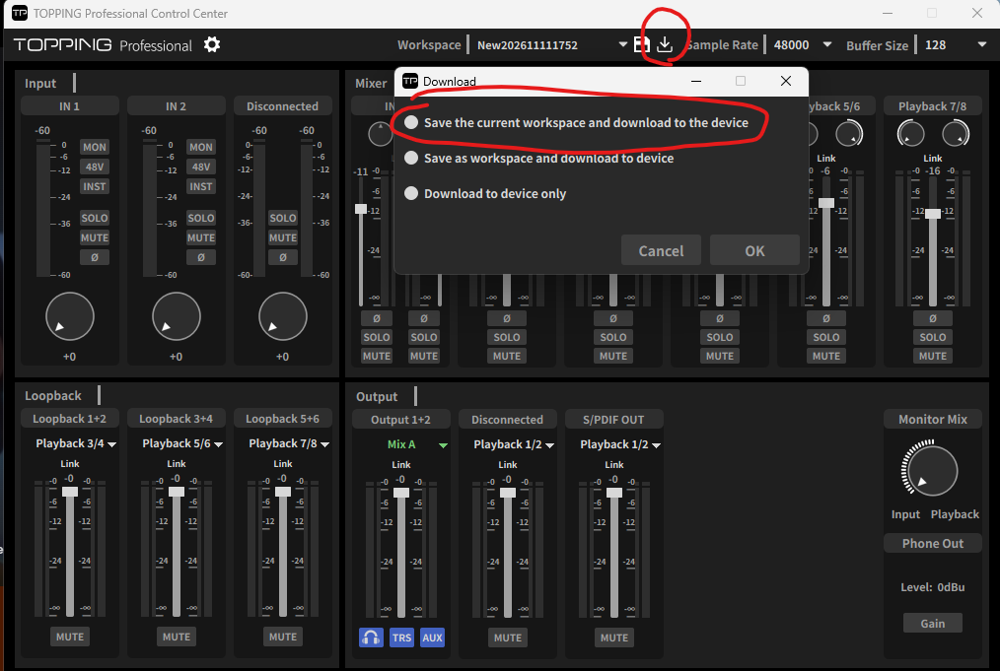

# Controller for TOPPING E2x2 OTG (Stream Deck プラグイン)

[한국어](README.md) | [English](README.en.md) | **日本語**

Elgato Stream Deck のキーとダイヤルで **TOPPING E2x2 OTG** ミキサーを操作するプラグインです。デバイスと USB (HID) で直接通信します。キーごとに Mix とチャンネルを決めておくと、TOPPING アプリの画面にどの Mix が表示されていても、決めた対象だけが動きます。

## 最初に必ずお読みください (制限事項)

**このプラグインが変更した値は TOPPING アプリの画面には表示されません。また、アプリがその値を上書きすることがあります。**

デバイスは現在のミキサーの値を返してくれません。そのためプラグインはミキサーの値を自分で覚えておき、起動時と、ワークスペースファイル (`.TPwork`) が変わるたびに TOPPING アプリのワークスペースファイルを読んで値を合わせます。アプリで Mix の画面を切り替えたり、アプリを再起動したりすると、アプリは自分が覚えている値をデバイスに送り直します。

### おすすめの使い方 (4ステップ)

1. TOPPING アプリで音量を好みの値に合わせ、**ワークスペース (Workspace) を保存**します。
2. アプリ上部のワークスペース名の右にある**ダウンロードアイコン**をクリックします。
3. **"Save the current workspace and download to the device"** (現在のワークスペースを保存してデバイスにダウンロード) を選び、**OK** を押します。ワークスペースが保存され、デバイスにも書き込まれます。

   

4. Stream Deck で **Workspace 読み込みキー**を押して、そのワークスペースを読み込みます。これでデバイスとプラグインが同じ値になります。

その後は Stream Deck をメインに使えば大丈夫です。アプリで値をもう一度変えたときは、1〜4 をもう一度行ってください。

## 必要なもの

- Windows 10 以降
- Stream Deck ソフトウェア 7.3 以降
- TOPPING E2x2 OTG と **TOPPING 公式ドライバー** (ドライバーは変更しません)
- TOPPING アプリはインストールしたままでも、起動したままでも構いません。このプラグインはアプリと同じデバイスを一緒に使います。
- ダイヤルのアクションを使うには Stream Deck + が必要です。キーのアクションはすべての Stream Deck で使えます。

## インストール

`com.haeunga0822.topping-e2x2.streamDeckPlugin` をダブルクリックし、Stream Deck がインストールするか尋ねたら承認します。インストールすると、アクション一覧に **Controller for TOPPING E2x2 OTG** カテゴリーが追加されます。設定画面は韓国語・英語・日本語で表示でき、画面の一番上の **Language** で選びます (すべてのアクションに共通です)。画面の一番上には、上の制限事項の警告が常に表示されます。

## アクション

| アクション | できること |
| --- | --- |
| Mute | 対象のミュートをオン/オフ |
| Solo | Mix チャンネルのソロをオン/オフ |
| Input option (48V, INST, Ø) | IN 1、IN 2、Mobile 入力の 48V、INST、Ø (位相反転) |
| LINK | Mix ごとにステレオチャンネルをリンク/解除 |
| 출력 컨트롤룸 (出力コントロールルーム) | 出力のゲインボタンと、モニターの HP / TRS / AUX のオン/オフ |
| Fader | 音量を決めた値に合わせる、または1段ずつ上げ下げする |
| Button fader (2 keys) | 2つのキー (上・下、または左・右) で音量を上げ下げ (長押しで連続) |
| VU dial | 回すと音量、押すとミュート、レベルメーターも表示 |
| Pan | Mix チャンネルのパン (キー) |
| Pan dial | Mix チャンネルのパン (ダイヤル、押すと中央) |
| 디지털 게인 (デジタルゲイン) | 入力のデジタルゲイン (キー) |
| 디지털 게인 다이얼 (デジタルゲイン ダイヤル) | 入力のデジタルゲイン (ダイヤル、押すと入力をミュート) |
| Source select | ループバックと出力 (OUT 1/2、Mobile OUT、S/PDIF OUT) に送る音を選ぶ |
| Workspace load/save | ワークスペースファイルを読み込む / 現在の値を新しいワークスペースファイルとして保存 |

出力コントロールルーム、デジタルゲイン、デジタルゲイン ダイヤルのアクション名 (출력 컨트롤룸、디지털 게인、디지털 게인 다이얼) は、どの言語でも Stream Deck のアクション一覧に韓国語で表示されます。

Fader、Button fader、VU dial、Mute の対象には、**Mix チャンネル** (Mix A〜D のチャンネル)、**ループバック**、**出力**のどれかを選びます。LINK をオフにするとステレオチャンネルは L/R の2つになり、Mute・Solo・Pan のキーでは対象としてペア全体 / L / R を選べます。

Source select には3つの方式があります。Mix を A → B → C → D と順に切り替える、選んだ候補の中で順に切り替える、2つの候補の間で切り替える、です。

Workspace の保存は、TOPPING アプリが今使っているファイルを上書きしません (アプリは終了時に自分の値でファイルを書き直すためです)。新しい名前で保存するので、アプリのワークスペース一覧から開けます。ただし TOPPING アプリは開いているワークスペースを**終了時にだけ**記録するため、アプリで開いている名前では保存しないでください。上書きされたワークスペースは、同じフォルダーに隠しバックアップ `.E2X2_OTG_<名前>.TPwork.bak` として残ります。

## レベルメーター

- メーターは**音が出ているときだけ**動きます。
- メーターはチャンネルごとにあります。Mix チャンネルのキー (Playback) はそのチャンネル自身のメーター、ループバックはループバックのメーター、出力は出力のメーターを表示します。
- IN 1/2 と OTG はメーターのコードがまだ分かっていないため、バーは空のままです。Playback 5/6・7/8 と Loopback 3/4・5/6 は推定値なので、実機での確認が必要です。
- 音量キー、2キーのフェーダー、VU ダイヤルは L/R を個別に選べず、常に両側 (ペア) に対して動作します。
- すべてのチャンネルキーは、**Name** 欄に名前を入力するとその名前を表示します (空欄ならデフォルトの名前、最大24文字)。

## 既知の制限

- 入力の **Solo** はデバイス上で何の効果もありません。
- 音量は最大 **+12 dB**、デジタルゲインは **0 〜 +20 dB** で、どちらも実機で確認済みです。**LINK 状態でのパンの曲線**は、TOPPING アプリとまだ比べていません。
- **48V** は、選んだときに設定画面へ警告を表示するだけです。キーを押すとすぐにオンになるので、コンデンサーマイク以外のマイクや機器を接続したままオンにしないよう注意してください。
- このプラグインはデバイスの USB ドライバーを変更しません。公式ドライバーで開ける HID 通信だけを使います。

## 開発

```
npm install
npm test          # ビルドしてからすべてのテストを実行
npm run pack      # com.haeunga0822.topping-e2x2.streamDeckPlugin を作成
```

USB 通信の解析結果は [docs/usb-protocol.md](docs/usb-protocol.md)、設計は `docs/superpowers/specs/` にあります。使用しているオープンソースの表示は [THIRD-PARTY-NOTICES.txt](THIRD-PARTY-NOTICES.txt) にあります。
