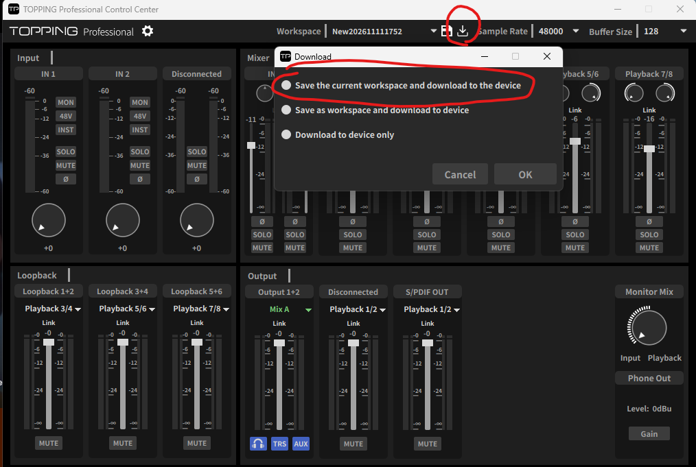

# Controller for TOPPING E2x2 OTG (Stream Deck 플러그인)

**한국어** | [English](README.en.md) | [日本語](README.ja.md)

Elgato Stream Deck의 키와 다이얼로 **TOPPING E2x2 OTG** 믹서를 조작하는 플러그인입니다. 장치와 USB(HID)로 직접 통신하며, 키마다 Mix와 채널을 정해 두면 토핑 앱 화면에 어떤 Mix가 떠 있든 정해 둔 대상만 움직입니다.

## 다운로드

[최신 릴리즈](https://github.com/KimTaehan0822/streamdeck-TOPPING-E2x2-OTG-Controller/releases/latest) 페이지에서 `TOPPING-E2x2-OTG-StreamDeck-v<버전>.zip`을 받아 압축을 풉니다. 안에 들어 있는 파일은 아래와 같습니다.

- `TOPPING-E2x2-OTG.streamDeckPlugin`: 설치 파일
- 사용설명서 PDF (언어별로 하나씩)
  - `Controller for TOPPING E2x2 OTG 스트림덱 플러그인 사용설명서.pdf`: 한국어
  - `Controller for TOPPING E2x2 OTG Stream Deck Plugin Manual (English).pdf`: 영어
  - `Controller for TOPPING E2x2 OTG Stream Deck プラグイン 取扱説明書 (日本語).pdf`: 일본어
- `LICENSE.txt`: 이 플러그인의 라이선스 (MIT)
- `THIRD-PARTY-NOTICES.txt`: 함께 쓰인 오픈소스 고지

## 먼저 꼭 읽어 주세요 (한계)

**이 플러그인이 바꾼 값은 TOPPING 앱 화면에 보이지 않습니다. 그리고 앱이 그 값을 다시 덮어쓸 수 있습니다.**

장치는 현재 믹서 값을 돌려주지 않습니다. 그래서 플러그인은 믹서 값을 직접 기억하고, 시작할 때와 작업 공간 파일이 바뀔 때마다 TOPPING 앱의 작업 공간 파일(`.TPwork`)을 읽어 값을 맞춥니다. 앱에서 Mix 화면을 바꾸거나 앱을 다시 켜면, 앱은 자기가 기억하는 값으로 장치를 되돌립니다.

### 권장 사용법

1. 스트림덱 위주로 사용합니다. **(중요) 스트림덱 플러그인과 토핑 컨트롤 센터 앱은 서로 실시간 연동이 되지 않습니다.**
2. TOPPING 앱 화면도 같은 값으로 맞추려면 **토핑 앱 다시 켜기** 키를 **토핑앱 설정 맞추기** 모드로 누릅니다. 저장·불러오기 키도 **토핑 앱 다시 켜서 맞추기**가 켜져 있으면 누를 때 같은 일을 합니다.

   > ⚠ 이때 **TOPPING 앱이 2~3초 꺼졌다 다시 켜집니다.** 앱에서 바꾸고 저장하지 않은 값은 사라집니다.

3. 잘못 덮어썼다면 같은 키의 **직전으로 되돌리기** 모드로 바로 전 값을 되살립니다.
4. TOPPING 앱에서 직접 값을 바꿨다면 앱에서 작업 공간을 저장하세요. 플러그인이 그 값을 다시 읽습니다.

오인페 전원을 껐다 켜도 값이 남게 하려면, 저장 키의 **장치에도 기록**을 켜 두거나 앱 위쪽 작업 공간 이름 오른쪽의 **다운로드 아이콘**에서 **"Save the current workspace and download to the device"** 를 고르고 **OK**를 누릅니다.



## 필요한 것

- Windows 10 이상
- Stream Deck 소프트웨어 7.3 이상
- TOPPING E2x2 OTG와 **TOPPING 공식 드라이버** (드라이버는 바꾸지 않습니다)
- TOPPING 앱은 설치해 두거나 켜 둬도 됩니다. 이 플러그인은 앱과 같은 장치를 함께 씁니다.
- 다이얼 액션을 쓰려면 Stream Deck +가 필요합니다. 키 액션은 모든 Stream Deck에서 쓸 수 있습니다.

## 설치

`TOPPING-E2x2-OTG.streamDeckPlugin` 파일을 더블클릭하고, Stream Deck이 설치할지 물으면 승인합니다. 설치 후 액션 목록에 **Controller for TOPPING E2x2 OTG** 카테고리가 생깁니다. 설정 화면은 한국어, English, 日本語로 볼 수 있습니다(화면 맨 위 **Language**에서 고르며 모든 액션에 공통 적용). 화면 맨 위에는 위의 한계 경고가 항상 표시됩니다.

## 액션

| 액션 | 하는 일 |
| --- | --- |
| Mute | 대상의 음소거 켜기/끄기 |
| Solo | Mix 채널의 솔로 켜기/끄기 |
| Input option (48V, INST, Ø) | IN 1, IN 2, Mobile 입력의 48V, INST, Ø(위상 반전) |
| LINK | Mix별로 스테레오 채널 묶기/풀기 |
| 출력 컨트롤룸 | 출력 게인 버튼, 모니터 HP / TRS / AUX 켜기·끄기 |
| Fader | 볼륨을 정해 둔 값으로 맞추거나 한 단계씩 올리고 내리기 |
| Button fader (2 keys) | 키 두 개(위·아래 또는 왼쪽·오른쪽)로 볼륨 올리기 / 내리기 (누르고 있으면 반복) |
| VU dial | 돌리면 볼륨, 누르면 Mute, 레벨미터 표시 |
| Pan | Mix 채널의 Pan (키) |
| Pan dial | Mix 채널의 Pan (다이얼, 누르면 가운데) |
| 디지털 게인 | 입력 디지털 게인 (키) |
| 디지털 게인 다이얼 | 입력 디지털 게인 (다이얼, 누르면 입력 음소거) |
| Output Source Select | 루프백과 출력(OUT 1/2, Mobile OUT, S/PDIF OUT)에 보낼 소리 고르기 |
| Workspace load/save | 작업 공간 파일 불러오기 / 현재 값을 새 작업 공간 파일로 저장하고, 고르면 장치에도 기록(전원을 꺼도 유지, 기본으로 켜짐) |

Fader, Button fader, VU dial, Mute는 대상으로 **Mix 채널**(Mix A~D의 채널), **루프백**, **출력** 중 하나를 고릅니다. LINK를 끄면 스테레오 채널이 L/R 두 개가 되고, Mute·Solo·Pan 키는 대상에서 짝 전체 / L / R을 고를 수 있습니다.

Output Source Select는 세 가지 방식이 있습니다: Mix를 A → B → C → D로 번갈아 가기, 고른 후보 안에서 번갈아 가기, 두 후보 사이 토글.

Workspace의 저장은 TOPPING 앱이 지금 쓰고 있는 파일을 덮어쓰지 않습니다(앱이 끌 때 자기 값으로 다시 덮어쓰기 때문). 다른 이름으로 새로 저장하고, 앱의 작업 공간 목록에서 열 수 있습니다. 플러그인은 TOPPING 앱의 기록(로그)을 읽어 앱이 지금 연 작업 공간을 알아내므로, 그 이름으로는 저장하지 않고, 앱에서 불러온 작업 공간도 몇 초 안에 키에 반영됩니다. 새로 저장한 작업 공간은 앱을 다시 켜야 앱 목록에 나옵니다. 덮어쓴 작업 공간은 같은 폴더에 숨김 백업 `.E2X2_OTG_<이름>.TPwork.bak` 으로 남습니다.

## 레벨 미터

- 미터는 **소리가 나올 때만** 움직입니다.
- 미터는 채널마다 있습니다. Mix 채널 키(Playback)는 그 채널 자신의 미터, 루프백은 루프백의 미터, 출력은 출력의 미터를 보여 줍니다.
- OTG는 미터 코드를 아직 몰라서 막대가 비어 있습니다.
- 볼륨 키, 2키 페이더, VU 다이얼은 L/R을 따로 고르지 않고 항상 양쪽(페어)에 동작합니다.
- 모든 채널 키는 **Name** 칸에 이름을 적으면 그 이름을 표시합니다(비우면 기본 이름, 최대 24자).

## 알려진 한계

- 입력의 **Solo**는 장치에서 아무 효과가 없습니다.
- 볼륨은 최대 **+12 dB**, 디지털 게인은 **0 ~ +20 dB**이고, **LINK 상태의 Pan**도 토핑 앱과 똑같이 움직입니다. 셋 다 실제 장치에서 확인했습니다.
- **48V**는 켤 때 설정 화면에 경고만 표시합니다. 키를 누르면 바로 켜지므로, 콘덴서가 아닌 마이크나 장비를 연결한 채 켜지 않도록 주의하세요.
- 이 플러그인은 장치 USB 드라이버를 바꾸지 않습니다. 공식 드라이버로 열 수 있는 HID 통신만 씁니다.

## 개발

```
npm install
npm test          # 빌드 후 전체 테스트
npm run pack      # com.haeunga0822.topping-e2x2.streamDeckPlugin 만들기
node docs/manual/make-pdf.mjs   # 사용설명서 PDF (Edge, Noto Sans KR/JP 필요)
```

USB 통신 분석 결과는 [docs/usb-protocol.md](docs/usb-protocol.md), 설계는 `docs/superpowers/specs/`에 있습니다. 함께 쓰인 오픈소스 고지는 [THIRD-PARTY-NOTICES.txt](THIRD-PARTY-NOTICES.txt)에 있습니다.
